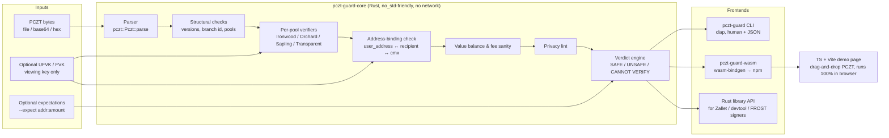
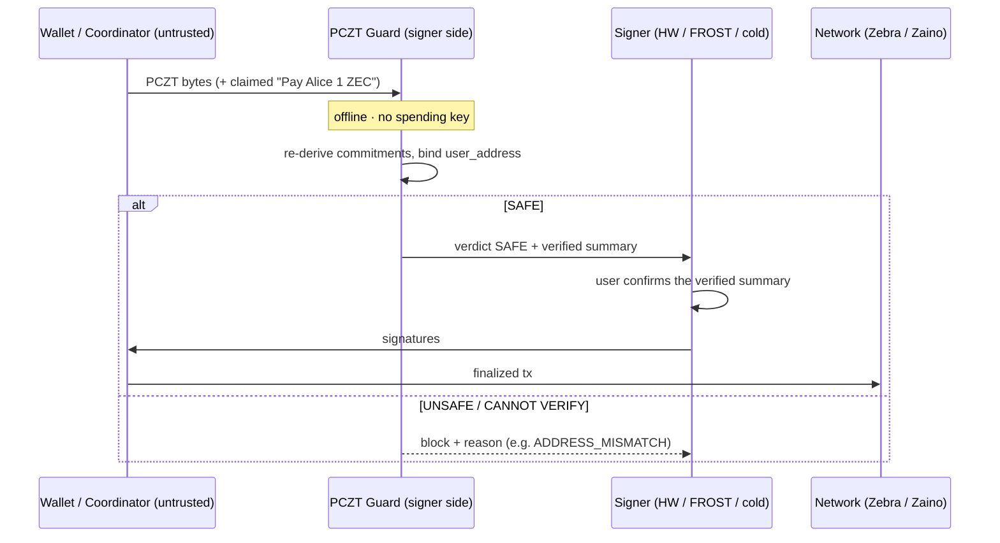

# PCZT Guard — Design Document

> **"Check the cheque before you sign it."**
> An independent, offline pre-signing verifier for Zcash PCZTs (Partially Created Zcash Transactions).

| | |
|---|---|
| **Hackathon** | Zecathon 2026 |
| **Track** | Core & Tooling ($15,000) |
| **Team** | Solo (Rust + TypeScript) |
| **Submission deadline** | **Oct 28 2026, 23:59 UTC** |
| **Status** | Phase 2 — Design (awaiting sign-off) |
| **License** | MIT OR Apache-2.0 (matches librustzcash) |
| **Doc date** | Oct 18 2026 |

---

## 1. One-paragraph summary

A PCZT is a Zcash transaction that one party builds and another party signs. This lets a hardware wallet, a FROST co-signer, a multisig participant, or a cold wallet approve a payment without holding the whole wallet. Today the Signer in the official `pczt` crate checks only part of what it signs. It **never checks that the address shown to the user (`user_address`) is the address the money actually goes to** ([librustzcash#3155](https://github.com/zcash/librustzcash/issues/3155), open and unassigned). A malicious or buggy constructor can therefore display *"Pay Alice 1 ZEC"* while the cryptographic commitments pay the attacker. **PCZT Guard** is a small Rust library, CLI and WebAssembly package that any signer runs *before* signing. It re-derives every commitment it can, checks that the displayed addresses and values match what is cryptographically committed, lints for privacy leaks, and returns one of three verdicts: **SAFE**, **UNSAFE**, or **CANNOT VERIFY**.

---

## 2. The problem, in plain language

### 2.1 The cheque analogy
- Someone hands you a cheque to sign, with a sticky note on top that says *"Pay Alice 1 ZEC"*.
- The sticky note is `user_address`. It is what wallets and devices **display**.
- The cheque underneath holds the cryptographic commitments (`cmx`, `cv_net`, ciphertexts). That is what the blockchain **executes**.
- The current `pczt` Signer signs the cheque **without checking that the sticky note matches it**.

### 2.2 The attack (address deception)
1. The victim's wallet (or a coordinator, plugin, or compromised laptop) builds a PCZT paying Alice.
2. The attacker changes the Orchard/Ironwood output: new `recipient`, recomputed `cmx`, `cv_net` and ciphertext, all paying the attacker. **`user_address` still says Alice.**
3. The signing device shows "Pay Alice 1 ZEC". The user approves.
4. `pczt::roles::signer::Signer` checks only `spend.verify_nullifier(None)` and signs.
5. The funds go to the attacker, irreversibly. Because it is shielded, nobody can see it on-chain.

### 2.3 Who is exposed today (verified Oct 2026)

| Signer / tool | What it checks | Gap |
|---|---|---|
| `pczt` crate `Signer` (librustzcash) | spend nullifier only | No output/`user_address` check (#3155) |
| Zallet `pczt_sign` / `pczt_inspect` | forwards to the stock Signer; docs say data is "not cryptographically verified" | Same |
| zcash-devtool `pczt inspect` | echoes `user_address` | No binding check |
| WebZjs `pczt.rs` | nothing | Everything |
| FROST co-signers (Zkool, NoirWallet, OpenPGP-Wallet/frost-zec) | each writes its own ad-hoc "ZIP 374 signer checks" | Duplicated, unaudited effort |
| Keystone firmware (`rust/apps/zcash/src/pczt/check.rs`) | cv_net, nf/rk, note commitment, transparent address↔script | Embedded in firmware, not reusable |
| Veyrin, PCZTKit | display diff only / empty scaffold | No cryptographic verification |

**Why now:** Ironwood (NU6.3) made PCZTs the standard way to migrate (`zcash_pool_migration` is PCZT-based). zcashd is end-of-life, so Zallet and PCZT flows are the default. NU7 is live on Testnet and targets Mainnet around Nov 5. Every new signer being written this month inherits the gap.

---

## 3. Goals and non-goals

### Goals
1. **G1 — Address binding:** For every shielded output, prove that `user_address` decodes to the same raw receiver as the committed `recipient`, and that `recipient + value + rseed` reproduce `cmx`. This is the fix for #3155.
2. **G2 — Full re-derivation:** Run every verification the pczt/orchard/sapling/transparent crates already expose (`verify_cv_net`, `verify_nullifier`, `verify_rk`, `verify_note_commitment`, `verify_cross_address_restriction`, transparent `verify`) and report the results in one place.
3. **G3 — Honest verdicts:** If data needed for a check is redacted, missing, or unknown, the verdict is **CANNOT VERIFY**, never SAFE.
4. **G4 — Privacy lint:** Flag privacy leaks before signing: transparent inputs or change, turnstile-visible Orchard→Ironwood amounts, unique "fingerprint" amounts, and memos sent to transparent receivers.
5. **G5 — Embeddable everywhere:** One Rust core crate, used from a CLI, from Rust signers as a library, and from JS/TS (browser or Node) via WASM.
6. **G6 — Upstream path:** Package the `user_address` check as a PR proposal for librustzcash#3155.

### Non-goals
- Not a wallet. It never holds or asks for a **spending key**.
- Not a signer. It does not produce signatures, and the PCZT is never mutated.
- No network access in the core. It is fully offline; no lightwalletd/Zaino calls are needed.
- It does not protect against a compromised signing device or malware that alters the *verdict display* itself (see the threat model).
- No proof verification of Halo2/Groth16 proofs in the MVP. Proofs are usually added after signing, and the consensus layer checks them.

---

## 4. Hackathon fit

| Judging criterion | How PCZT Guard scores |
|---|---|
| **Privacy** ("leaks are disqualifying") | Offline, no keys, no telemetry. Actively *lints* privacy leaks in the transaction. |
| **Usefulness** ("use on Monday") | `cargo add pczt-guard`, `npm i pczt-guard`, or `pczt-guard check tx.pczt`. It drops into Zallet, devtool, WebZjs and FROST flows. |
| **Execution** ("working beats ambitious") | A narrow scope built on existing verified primitives. The demo is a real attack caught live. |
| **Originality** | First reusable, wallet-agnostic PCZT verifier that fixes an open upstream security issue. |

---

## 5. Architecture



### Components

| Component | Language | Responsibility |
|---|---|---|
| `pczt-guard-core` | Rust | All verification logic. Pure function `verify(pczt_bytes, opts) -> Report`. No I/O, no network, no randomness. |
| `pczt-guard-cli` | Rust (`clap`) | `pczt-guard check <file>` with `--ufvk`, `--expect`, `--json`, `--strict`. Exit codes: 0 = SAFE, 1 = UNSAFE, 2 = CANNOT VERIFY, 3 = parse error. |
| `pczt-guard-wasm` | Rust → WASM (`wasm-bindgen`, `wasm-pack`) | `verify(bytes: Uint8Array, opts) -> Report` (JSON). Published as an npm package. |
| `web-demo` | TypeScript + Vite | Static page: drop a PCZT and see the verdict. Runs entirely client-side and works offline once loaded. |
| `fixtures/` + `xtask` | Rust | Generates honest and tampered PCZTs for tests and the demo. |

---

## 6. Verification pipeline

Checks run in this order. Each produces a `Finding { id, severity, pool, index, message }`.

| # | Stage | What it does | Primitive used (verified to exist) | Failure → |
|---|---|---|---|---|
| 1 | **Parse** | Decode v1/v2 PCZT encoding | `pczt::Pczt::parse` | parse error (exit 3) |
| 2 | **Structural** | Tx version, consensus branch ID, which pools have data | `Pczt::has_data_in_pool(PoolType)` | UNSAFE if inconsistent |
| 3 | **Ironwood bundle** | cv_net, nullifier, rk, note commitment for each action | `Verifier::with_ironwood` → orchard `verify_cv_net`, `verify_nullifier`, `verify_rk`, `verify_note_commitment` | UNSAFE |
| 4 | **Orchard bundle** | Same as stage 3, plus the post-NU6.3 cross-address restriction | `Verifier::with_orchard` → same + `Bundle::verify_cross_address_restriction` | UNSAFE |
| 5 | **Sapling bundle** | cv, nullifier, rk, note commitment | sapling-crypto `pczt::verify` (`verify_cv`, `verify_nullifier`, `verify_rk`, `verify_note_commitment`) | UNSAFE |
| 6 | **Transparent bundle** | Input/output consistency; `user_address` ↔ `script_pubkey` | zcash_transparent `pczt::verify` | UNSAFE |
| 7 | **⭐ Address binding (NEW)** | For each output: decode `user_address` with `zcash_address`, pick the receiver for this pool, and compare its raw 43 bytes with `recipient.to_raw_address_bytes()`. The committed `cmx` was already proven in stage 3–5 to match `recipient`. | `zcash_address::ZcashAddress` + `orchard::Address::to_raw_address_bytes` | **UNSAFE: ADDRESS_MISMATCH** |
| 8 | **Ownership (if FVK given)** | Spends belong to the supplied key; change outputs go back to it | `verify_nullifier(Some(fvk))`, `verify_rk(Some(fvk))`, `recover_output_with_ovk` | UNSAFE |
| 9 | **Value balance & fee** | Σin − Σout = fee; fee within ZIP 317 bounds; flag absurd fees | values from bundles | UNSAFE (mismatch) / WARN (high fee) |
| 10 | **Expectations** | If the user supplied `--expect addr:amount`, those exact payments must exist | report | UNSAFE |
| 11 | **Privacy lint** | See §8 | report | WARN (or UNSAFE with `--strict`) |
| 12 | **Verdict** | Aggregate | — | SAFE / UNSAFE / CANNOT VERIFY |

### Verdict rules
- **UNSAFE** if any check *fails*.
- **CANNOT VERIFY** if no check fails but any *required* field is redacted or missing (`recipient`, `value`, `rseed`, `rcv`, or `user_address` on a non-change output).
- **SAFE** only when every output is bound and every check passed.

### Special cases that must NOT raise false alarms
- **ZIP 326 dummy outputs:** zero-value outputs whose `enc_ciphertext` is deliberately random (restricted builder). The note commitment is still verified; ciphertext decryption failure is tolerated. This matches PR #3042's documentation.
- **ZIP 374 deferred anchors:** for v6+ transactions, a Signer MAY sign with an absent witness/anchor. Report INFO, not failure. This matches `AnchorRequirement::for_pre_authorization`.
- **Change outputs** have no `user_address`. With an FVK, prove they are ours via OVK recovery. Without one, report "unlabeled output, value X". If such outputs exist, the result is CANNOT VERIFY unless `--allow-unlabeled-change` is set.

### Address-binding check (stage 7)

```text
for each shielded output o in pool P:
    if o.recipient is None or o.rseed is None or o.value is None:
        → CANNOT_VERIFY(pool, i, "redacted")
    note_commitment already verified in stage 3–5  (recipient,value,rseed ⇒ cmx)
    match o.user_address:
        None      → treat as change (see special cases)
        Some(s)   →
            addr = ZcashAddress::try_from_encoded(s)?          // else UNSAFE: BAD_ADDRESS
            check network(addr) == network(pczt)                // else UNSAFE: WRONG_NETWORK
            r = receiver_for_pool(addr, P)                      // UA: pick Orchard/Sapling item
                                                                // else UNSAFE: NO_RECEIVER_FOR_POOL
            if r.raw_bytes != o.recipient.to_raw_address_bytes():
                → UNSAFE: ADDRESS_MISMATCH  (show both addresses)
```

---

## 7. Data flow: which pools are touched

PCZT Guard **moves no value**. It only reads a PCZT. The table shows which pools each check reads in the transactions it inspects.

| Transaction type under inspection | Pools read | Checks emphasised |
|---|---|---|
| Ironwood → Ironwood payment (default post-NU6.3) | Ironwood | Stages 3, 7, 9 |
| Orchard → Ironwood migration (`zcash_pool_migration`) | Orchard (spend), Ironwood (output), turnstile | Stages 3, 4, 7 + turnstile-amount lint |
| Sapling legacy spend | Sapling (→ Ironwood) | Stages 5, 7 |
| Shielding / de-shielding | Transparent ↔ shielded | Stage 6 + transparent lint |



---

## 8. Privacy lint rules

| ID | Rule | Default severity |
|---|---|---|
| `PL01` | Transaction spends transparent inputs (links to public history) | WARN |
| `PL02` | Change goes to a transparent address | WARN (UNSAFE with `--strict`) |
| `PL03` | Orchard→Ironwood turnstile crossing reveals the exact amount; suggest splitting/rounding | INFO |
| `PL04` | Highly unique amount (many significant digits) crossing a public boundary | INFO |
| `PL05` | Memo present on an output to a transparent receiver (memo would be lost) | WARN |
| `PL06` | Mixed pools in one tx (Sapling + Ironwood) that increase linkability | INFO |
| `PL07` | Fee far above the ZIP 317 conventional fee (fingerprintable) | WARN |

---

## 9. Threat model

### Assets
The user's funds; the integrity of what the user believes they are signing; the privacy of the transaction.

### Trust assumptions
- **Trusted:** the PCZT Guard binary/WASM (reproducible build, open source), the device it runs on, and the viewing key the user supplies.
- **Untrusted:** the PCZT constructor, the coordinator, network transport, and any `user_address`/label field.

### Threats

| # | Threat | Attacker | Mitigation in Guard | Residual risk |
|---|---|---|---|---|
| T1 | **Address deception**: `user_address` ≠ committed recipient | Malicious constructor / coordinator | Stage 7 binding + stage 3–5 cmx re-derivation | None for complete PCZTs |
| T2 | **Value deception**: displayed value ≠ `cv_net` | Same | `verify_cv_net` / `verify_cv` | None |
| T3 | **Hidden extra output** (an unlabeled output to the attacker) | Same | Unlabeled outputs → CANNOT VERIFY unless proven change via FVK/OVK | Users who override with `--allow-unlabeled-change` |
| T4 | **Redaction downgrade**: strip `rseed`/`recipient` so checks are skipped | Same | Missing data → CANNOT VERIFY (never SAFE) | None |
| T5 | **Spend of someone else's / wrong-account note** | Same | `verify_nullifier`/`verify_rk` with FVK | Without an FVK only internal consistency is proven |
| T6 | **Cross-pool trick**: Orchard→foreign-address after NU6.3 | Same | `verify_cross_address_restriction` | None |
| T7 | **Network confusion** (testnet address in a mainnet tx) | Same | Network check in stage 7 | None |
| T8 | **Fee drain** | Same | Value balance + fee bound | User accepts high fee |
| T9 | **Malformed input → crash/DoS** | Anyone | Fuzzing (`cargo-fuzz`) on the parser entry; no `unwrap` on input paths | Low |
| T10 | **Ciphertext mismatch** (valid cmx, but `enc_ciphertext` decrypts to a different note, so the recipient can't spend) | Same | *Stretch:* recompute esk from rseed and decrypt with the sender-side shared secret | Unchecked in MVP → reported as INFO |

### Out of scope (stated explicitly)
- A compromised signing device, or malware that rewrites Guard's output.
- Side channels on the host.
- Consensus-level validity (proofs, anchors against the chain). Zebra checks those.

### Privacy of the tool itself
No network calls. No telemetry. The WASM demo is a static page with no analytics; keys and PCZTs never leave the browser. The CLI never writes keys to disk. Viewing keys are accepted via stdin/env, never logged.

---

## 10. Tech stack (versions verified Oct 18 2026)

### Languages
| Language | Where | Why |
|---|---|---|
| **Rust** (edition 2021, MSRV 1.89 to match librustzcash's `rust-toolchain.toml`) | core, CLI, WASM | Same language and crates as the Zcash reference stack; reuse audited primitives. |
| **TypeScript** | web demo, npm typings | The browser demo and the JS wallet ecosystem (WebZjs users). |
| **Markdown / Mermaid** | docs | Submission and upstream proposal. |

### Rust crates

| Crate | Version | Use |
|---|---|---|
| `pczt` | **0.10.0-pre.2** (or git pin to librustzcash `main` at a fixed commit) | Parse, `Verifier::with_orchard` / `with_ironwood`. Ironwood bundle support is confirmed on `main`/0.10 line; **0.9.3 stable is not assumed to support Ironwood.** |
| `orchard` | 0.16.0 | `pczt::{Bundle, Action, Output}` verify methods, `Address::to_raw_address_bytes` |
| `sapling-crypto` | 0.9.0 | Sapling pczt verify |
| `zcash_transparent` | 0.11.0-pre.2 (paired with pczt pre) | Transparent pczt verify |
| `zcash_address` | 0.14.0-pre.2 (paired) | Decode `user_address`, UA receivers |
| `zcash_keys` | 0.17.0-pre.2 (paired) | Parse UFVK input |
| `zcash_protocol` | 0.11.0-pre.1 | Network / consensus params, `PoolType` |
| `clap` | 4.x | CLI |
| `serde`, `serde_json` | 1.x | JSON report |
| `thiserror` | 2.x | Errors |
| `wasm-bindgen`, `serde-wasm-bindgen` | latest | WASM bindings |
| `cargo-fuzz` (dev) | latest | Parser fuzzing |

> **Pinning rule:** all `zcash_*`/`pczt` crates are pinned to the *same* librustzcash release set (`=` versions or one git `rev`), exactly as the librustzcash workspace does. Mixing stable and pre-release lines is a known source of type mismatches.

### Frontend
TypeScript 5, Vite, plain DOM (no framework needed), and the `pczt-guard-wasm` package from `wasm-pack build --target web`.

### Local tooling status (verified Oct 18)
- ✅ rustc/cargo 1.95.0 (newer than MSRV 1.89).
- ✅ `wasm-pack` 0.15.0 installed.
- ✅ `wasm32-unknown-unknown` target installed.
- ✅ Node.js v24.15.0 / npm 11.12.1.
- ✅ clang is needed **only** for the `transparent` feature on wasm32, because `secp256k1-sys` is C code. Two working options, both verified with the full feature set (`std, orchard, sapling, transparent`) via `cargo check --target wasm32-unknown-unknown`:
  - **Windows:** LLVM 22.1.8 (official GitHub release, SHA-256 `16e57097…e55c` matched) at `C:\Program Files\LLVM\bin`. Prepend it to `PATH` for wasm builds.
  - **WSL Ubuntu 22.04:** apt clang 14 + cargo 1.99.1.
- ✅ A probe crate using `pczt =0.10.0-pre.2` (`std, orchard, sapling, transparent`) + `orchard 0.16` + `zcash_address =0.14.0-pre.2` + `zcash_protocol =0.11.0-pre.1` compiles **natively and for wasm32**. The probe calls `Verifier::with_ironwood`, `Output::{recipient, user_address}`, `Address::to_raw_address_bytes`, `verify_cv_net` and UA receiver matching.
- ℹ️ `zcash_address` 0.14 API note: `unified::Address::decode` returns `(NetworkType, Revision, Address)`.

### Test-network tooling
- `zcash-devtool` (Testnet wallet that creates PCZTs: `pczt create`, `pczt sign`, …).
- Zebra 7.0.0-rc.0 / Zakura and Zaino 0.10.1, used only to *produce* real testnet PCZTs and broadcast honest ones. Guard itself never touches the network.
- Testnet only. **No mainnet keys anywhere in the repo.**

---

## 11. Open assumptions (to confirm on day 1)

| # | Assumption | Status | Fallback |
|---|---|---|---|
| A1 | Ironwood outputs are addressed with the **Orchard receiver** (typecode 0x03) in Unified Addresses; there is no separate Ironwood typecode | ✅ **Verified.** `zcash_keys 0.17.0-pre.2` `Address::can_receive_as`: *"Ironwood shares the Orchard receiver"*. `zcash_address 0.14.0-pre.2` has no Ironwood typecode. | If a new typecode lands, add it to `receiver_for_pool`. |
| A2 | `pczt` 0.10.0-pre.2 on crates.io includes `with_ironwood` | ✅ **Verified.** The published crate source has `Verifier::with_ironwood`, and the probe compiles against it. 0.9.3 stable is **not** used. | Git-pin `rev = eb38d7a3…` (the same rev zcash-devtool pins) |
| A3 | `orchard::pczt::Output` getters (`recipient()`, `value()`, `rseed()`, `user_address()`) are public via `getset` | ✅ Verified by compiling the probe | — |
| A4 | zcash-devtool can produce Ironwood PCZTs on Testnet today | ⚠️ **Partly verified (code review, not yet run).** devtool pins `pczt =0.10.0-pre.2` + librustzcash `rev eb38d7a3` and has `migration {plan,advance,commit}` + `pczt create_max` (Ironwood). `pczt create` uses an Orchard fallback change pool, which `zcash_client_backend` **promotes to Ironwood after NU6.3**. Testnet server `testnet.zec.rocks:443` is reachable. Still needed: testnet ZEC from a faucet and a real run. | Generate fixtures in-process with the pczt Creator/builder |
| A5 | The June 2026 "ciphertext authentication" finding mentioned in #3155 | **Unverified.** Do not cite as fact. | Only cite #3155 itself |

---

## 12. Repository layout

```text
pczt-guard/
├── Cargo.toml                 # workspace, pinned zcash crate set
├── rust-toolchain.toml        # 1.89 (matches librustzcash)
├── crates/
│   ├── pczt-guard-core/       # verify(), Report, Finding, rules
│   │   ├── src/{lib,report,binding,pools/{ironwood,orchard,sapling,transparent},value,privacy}.rs
│   │   └── tests/             # fixtures-based integration tests
│   ├── pczt-guard-cli/        # clap binary `pczt-guard`
│   └── pczt-guard-wasm/       # wasm-bindgen wrapper
├── web-demo/                  # TypeScript + Vite static page
├── fixtures/                  # honest + tampered *.pczt (testnet only)
├── xtask/                     # fixture generator: honest → tamper scenarios
├── fuzz/                      # cargo-fuzz target on parse+verify
├── docs/
│   ├── upstream-3155-proposal.md
│   └── integration-guide.md   # Zallet / devtool / WebZjs / FROST snippets
└── README.md
```

---

## 13. Public API (draft)

```rust
pub struct Options {
    pub ufvk: Option<zcash_keys::keys::UnifiedFullViewingKey>,
    pub expectations: Vec<Expectation>,       // (address, zatoshis)
    pub allow_unlabeled_change: bool,
    pub strict_privacy: bool,
}

pub enum Verdict { Safe, Unsafe, CannotVerify }

pub struct Report {
    pub verdict: Verdict,
    pub summary: Vec<PaymentLine>,  // pool, verified address, value, memo?
    pub fee: Option<u64>,
    pub findings: Vec<Finding>,     // id, severity, pool, index, message
}

pub fn verify(pczt_bytes: &[u8], opts: &Options) -> Result<Report, ParseError>;
```

CLI output (human mode):
```text
$ pczt-guard check payment.pczt
✖ UNSAFE
  [ADDRESS_MISMATCH] Ironwood output #0
     shown:     utest1alice…k9
     committed: utest1mallory…3x   (cmx verified ✔)
  value 1.00000000 ZEC · fee 0.00010000 ZEC
```

---

## 14. Test plan

| Layer | What | How |
|---|---|---|
| Unit | Each stage with hand-built bundles | `cargo test` |
| Fixtures | **Honest** PCZTs (Ironwood, Orchard→Ironwood, Sapling, shielding) → SAFE | `xtask gen` + testnet devtool exports |
| Attack corpus | Tamper scenarios, each → the expected finding: (1) swap recipient but keep `user_address`; (2) change value but keep display; (3) strip `rseed`; (4) add a hidden unlabeled output; (5) testnet address in a mainnet tx; (6) fee drain; (7) UA without a receiver for the pool | `xtask tamper` |
| False-positive guard | ZIP 326 dummy outputs; ZIP 374 absent anchors; change without `user_address` + FVK | fixtures |
| Differential | Stock `pczt::Signer` **signs** attack #1; Guard **rejects** it | integration test = demo script |
| Fuzz | Random bytes / mutated PCZTs never panic | `cargo fuzz run parse_verify` (time-boxed) |
| WASM parity | Same fixtures give identical JSON in native and WASM | `wasm-pack test --node` |
| E2E testnet | Honest PCZT passes Guard → signed → broadcast on Testnet | devtool + Zaino |

**Definition of done:** all fixtures green; zero false positives on the honest corpus; every attack scenario caught with the correct finding ID.

### 14.1 P1 findings (verified Oct 19 2026)

Fixtures are generated in-process — no Testnet funds, faucet or node needed (`cargo xtask fixtures`).

- **Recipe:** `zcash_primitives::transaction::builder::DeferredPcztBuilder` (ZIP 374, no witnesses) → `pczt::roles::creator::Creator::build_from_parts` → `pczt::roles::updater::Updater::update_ironwood_with` → `ActionUpdater::set_output_user_address`. That last call is what fabricates the lying label, and it is a **public API in `orchard`**.
- **The attack PCZT has nothing malformed in it.** `verify_cv_net`, `verify_nullifier(None)`, `verify_rk(None)` and `verify_note_commitment` all pass, because they are all true statements about a payment to the attacker. Only the `user_address` ↔ `recipient` comparison catches it. Tests: `xtask/tests/attack.rs`.
- **The stock Signer signs it.** `Signer::new(pczt)` + `sign_ironwood(rng, index, ask)` returns `Ok`. Note there are **two** unchecked entry points: `sign_orchard` (Orchard bundle) and `sign_ironwood` (Ironwood bundle).
- **Ironwood bundles are padded, so 1-in/1-out is 2 actions:**
  - the real spend is paired with a **zero-value dummy output** addressed to the spend's own receiver, with no `user_address` (ZIP 326 dummy);
  - a **zero-value dummy spend** is paired with the real output.
  Guard must therefore (a) treat `value == 0` actions as padding, not as findings, and (b) never assume the payment is action 0 — action order is shuffled, so indices come from `BundleMetadata`.
- **Fee for the fixture shape:** ZIP 317 charges 10,000 zats (2 actions × 5,000). Input 100,010,000 / output 100,000,000.

### 14.2 P2 day 1 findings (verified Oct 19 2026)

`crates/pczt-guard-core` now runs stages 1–5 and derives the verdict. 5 engine tests + 4 attack tests green, clippy clean.

- **`Pczt::global()` exists** (via a `Getters` derive), so `tx_version`, `consensus_branch_id` and `coin_type` are readable — the earlier worry that they were inaccessible was wrong.
- **Network comes from `coin_type`, and testnet/regtest both use 1.** Guard therefore reports `Network::Test` for either and can only catch a mainnet-vs-test mismatch.
- **Verdict rules are implemented and tested:** `Unsafe` if any finding is `Unsafe`; `CannotVerify` if the worst is `CannotVerify`; `Safe` otherwise. `Missing*` verify errors (redacted fields) map to `CannotVerify`, never to a pass.
- **Payments skip zero-value outputs**, which is how padding is excluded (see 14.1). The honest fixture reports exactly one payment of 1 ZEC.
- **Still open:** stage 6 (transparent), stage 7 (address binding), redaction fixtures, value balance/fee. Those are the next two days.

### 14.3 P2 day 2 findings (verified Oct 19 2026)

**Stage 7 works: the attack is caught.** `cargo run -p pczt-guard-core --example check -- fixtures/ironwood-address-tampered.pczt` prints `Unsafe` with a single `AddressMismatch` finding. The honest fixture prints `Safe` with `bound=true`. 10 engine tests + 4 attack tests green, clippy clean.

- **`ZcashAddress::matches_receiver(&Receiver)` is the binding primitive.** It takes the committed receiver (raw 43 bytes for Orchard/Ironwood, 20 for transparent) and answers whether the shown address contains it. Parsing the label ourselves or re-encoding the recipient would have been more code and more failure modes.
- **`can_receive_as(PoolType)` separates two different lies.** A label for another pool (`NoReceiverForPool`) is not the same failure as a label for a different payee (`AddressMismatch`). Ironwood must be mapped to `PoolType::ORCHARD` when asking, because Ironwood has no pool type of its own in `zcash_address`.
- **Zero-value outputs are dropped before binding**, which is what keeps padding from producing `UnlabeledOutput` on every honest transaction. Confirmed on the honest fixture: one payment, one finding-free report.
- **Transparent outputs are bound too**, using `TransparentAddress::from_script_pubkey` for the committed side. `zcash_address` 0.14 has no bare-transparent encoder, so the committed side is compared as raw receiver bytes and left unprinted in the report.
- **Redaction behaves as designed:** clearing `output_recipient` yields `CannotVerify` with `RedactedField`, and **no** `Unsafe` finding — unprovable, not disproven.
- **Known gap:** the *network prefix* of a `user_address` string is not checked. `zcash_address` 0.14 exposes no `network_type()`, and inferring it from the bech32 HRP is fragile. A testnet-labelled address inside a mainnet PCZT therefore passes stage 7 if its receiver bytes match. The PCZT's own network is still checked against `Options::expected_network`. Worth raising upstream alongside #3155.

### 14.4 P2 day 3 findings (verified Oct 19 2026)

Stage 9 is in, and the core engine is feature-complete for the design's scope. 14 integration + 5 unit tests green, clippy clean.

- **The fee is now stated, not implied.** `Report.fee` is `Some(10_000)` on the honest fixture: 100,010,000 in, 100,000,000 out. Almost no signer surfaces this number today, and it is the only way a user notices value leaving.
- **A bundle's declared net value can be cross-checked.** `ValueSum::magnitude_sign()` exposes the declared balance, which must equal `Σ spends − Σ outputs`. Verified empirically: the honest fixture declares `(10000, Positive)`, and a mismatch is `UNSAFE`. This catches a PCZT that lies to a Prover or to a signer that displays `value_sum`.
- **A high fee is a warning, not a verdict of dishonesty.** The drain fixture has a 0.99 ZEC fee — 9,900× the ZIP 317 conventional fee — and reports `Safe` with a `HighFee` warning. Calling it `UNSAFE` would be wrong: nothing in the PCZT is false, it is simply a terrible deal. Threshold: more than 10× `5000 × max(2, actions)`.
- **A redacted value gives `fee: None` plus an `Info`, never `Some(0)`.** A zero would be a lie about a number the tool cannot see.
- **Building a high-fee fixture needs a custom `FeeRule`.** `build_for_pczt` only accepts a transaction whose inputs exceed its outputs by exactly the fee its rule demands, so `xtask::inflated_fee` supplies a `FixedFee` rule. Useful trick for any future fee-related fixture.
- **ZIP 374 note:** `anchor_deferred()` is **false** on these fixtures — `serialize_from` materialises the empty-tree anchor, so the deferred-anchor `Info` never fires here. The tolerance itself is exercised (v6 PCZTs with absent witnesses verify) but the flag path is only covered by inspection, not by a fixture.
- **Value creation** (`Σ outputs > Σ inputs`) cannot be built through the real builder, so that branch is covered by unit tests on `Tally` rather than an end-to-end fixture.

### 14.5 P3 day 1 findings (verified Oct 19 2026)

The CLI exists: `crates/pczt-guard-cli`, binary `pczt-guard`. 9 CLI tests drive the compiled binary through `env!("CARGO_BIN_EXE_pczt-guard")`, so stdout, stderr and exit codes are asserted the way a script sees them. 33 tests green across the workspace, clippy clean.

```text
$ pczt-guard check fixtures/ironwood-address-tampered.pczt
UNSAFE
  fixtures\ironwood-address-tampered.pczt · testnet · tx v6 · ironwood

  ironwood 1.00000000 ZEC → utest1x7d90s60qlc5pp…swmzhgsckh3d  [NOT verified]
  fee      0.00010000 ZEC

  unsafe     AddressMismatch ironwood: the user is shown "utest1x7d90…" but the value is
             committed to utest1tuxnkpkk…
```

- **Exit codes are the interface.** 0 `SAFE`, 1 `UNSAFE`, 2 `CANNOT VERIFY`, 3 not-a-PCZT or bad usage. `pczt-guard check x.pczt || exit 1` is the whole integration for a signing script.
- **`--strict` lives in the core, not the CLI.** `Options::strict` folds a `Warn` into an `Unsafe` verdict, so a library user and a CLI user get the same answer for the same PCZT.
- **`[verified]` / `[NOT verified]` is the line that matters.** It states, per payment, whether the label was proven — the fact no current wallet shows.
- **`--json` emits the whole `Report`** (verdict, network, tx version, pools, payments with `bound`, fee, findings with codes), so a FROST coordinator or a Zallet hook can consume it without parsing prose.
- **`read_input` accepts `-`** for stdin, so a coordinator can pipe a PCZT straight in without a temp file.
- **Clippy caught a shape problem:** `Report::from_findings` had reached nine arguments. Replaced with a `report::Draft` struct, which is the better API regardless.
- **Not built yet:** `--expect addr:amount` (design stage 10). It needs the expected address decoded and compared against committed receivers inside the binding pass, so it is a real piece of work rather than a flag.

### 14.6 P3 day 2 findings (verified Oct 19 2026)

Privacy lints are in: PL01, PL02, PL03, PL04, PL06, and PL07 (which reuses the `HighFee` finding). 40 tests green, clippy clean, and `pczt-guard lints` lists them.

- **PL02 needs a proxy for "this output is my change".** A PCZT does not label change, and finding it properly needs a viewing key. The proxy used is `transparent::pczt::Output::bip32_derivation()`: a wallet sets a derivation for outputs it controls, so a non-empty one means a public change output. Heuristic, documented as such.
- **PL04 is a heuristic by nature.** It fires on an amount crossing a public boundary that is not a multiple of 0.01 ZEC. The threshold is documented rather than pretending the rule is precise.
- **PL05 is not implemented, on purpose.** "A memo that a transparent recipient silently discards" cannot be seen from a PCZT: the memo sits inside the encrypted note and the PCZT records no intent. `pczt-guard lints` says so in its own output rather than leaving a gap the user cannot see.
- **The lints are unit-tested on the facts they consume**, not through fixtures. Building a PCZT with transparent inputs, or with two shielded pools at once, needs a real UTXO set or a migration flow; that is fixture work for the attack-corpus day, not lint logic. The gathering code is exercised by every fixture (an Ironwood-only payment produces no lints — asserted).
- **A `Ctx` struct replaced the argument lists.** Threading `tally`, `privacy`, `findings` and `payments` through four functions reached clippy's argument limit and, more importantly, read badly. One accumulating context is the honest shape.
- **`--strict` now does real work:** PL01/PL02/PL07 are `Warn`, so strict mode blocks signing a transaction that leaks, even though nothing about it is false.

### 14.7 P3 day 3 findings (verified Oct 19 2026)

The browser build exists: `crates/pczt-guard-wasm` (1 MB wasm) and `web-demo/` (TypeScript + Vite). Verified in **headless Edge 155 against the built page**, not just by compiling:

| Sample | Verdict | Badge | Finding |
|---|---|---|---|
| honest | `SAFE` | verified | — |
| address-tampered | `UNSAFE` | not verified | `ADDRESS_MISMATCH` |
| fee-drain | `SAFE` | verified | `HIGH_FEE` |

- **The core needed two changes to build for wasm32,** both real portability bugs rather than config:
  - `getrandom` 0.4 refuses wasm32 without its `wasm_js` feature; the core needs no randomness, but the curve stack does.
  - `halo2_proofs`' `multicore` (rayon) does not build for wasm32 without atomics. Fixed by making `orchard` `default-features = false` at the workspace level and letting `xtask` (via `zcash_primitives`) opt into circuits. The browser build now leaves halo2 out entirely.
- **The wasm output matches the native output exactly** — same verdicts, same `bound` flags, same fee — checked through the `--target nodejs` build before the browser one.
- **`?sample=<name>` deep links** were added so the page can be driven without clicking. That is what made the headless verification possible, and it is also the easiest way to record the demo video.
- **One UI bug caught by the screenshot:** the meta line printed `test` instead of `testnet`. Fixed and re-verified.
- **`lint` moved onto `Finding`** (`Option<&'static str>`, omitted from JSON when absent) so the CLI and the browser show `PL07` without each re-deriving it from the code.
- **Not verified in a browser:** drag-and-drop and the file picker. They are plain DOM handlers and the same `verify` path is exercised by the samples, but no automated test drives them.

### 14.8 P4 findings (verified Oct 19 2026)

- **The most important finding of the build: real wallets do not label change.**
  `zcash_client_backend` 0.25 `src/data_api/wallet.rs:3161` calls `set_output_user_address`
  only when there is an `external_address`, i.e. only for outputs paying somebody else. Change
  carries a `PROPRIETARY_OUTPUT_INFO` and no `user_address`.
  Consequence, now covered by `xtask::payment_with_change()` and two tests: **every real
  wallet PCZT with change returns `CANNOT VERIFY` by default.** That is the *correct* answer —
  an unlabeled value-bearing output is indistinguishable from an attacker's hidden output —
  but it means the default verdict cannot be "sign this" for ordinary payments. The fix is
  not to weaken the check but to add the viewing-key path: prove change with the OVK, then
  it is `bound` rather than unlabeled. **Not implemented yet**; `allow_unlabeled_change` is
  the stopgap.
- **Robustness is now asserted, not assumed.** `tests/robustness.rs` feeds the verifier
  random bytes, every short truncation of a valid PCZT, sampled longer truncations, 150
  multi-byte mutations, and trailing garbage: no panics, ~10 s. Deterministic xorshift, no
  dependencies, runs on stable. A `cargo-fuzz` campaign remains available for longer runs but
  needs nightly.
- **`docs/integration-guide.md`** covers the library, the CLI, the wasm module, and drop-in
  snippets for Zallet, zcash-devtool, FROST coordinators and hardware wallets.
- **`docs/upstream-3155-proposal.md`** proposes `Output::verify_user_address(pool)` for the
  Orchard, Sapling and transparent PCZT types, with the absent-label and Ironwood cases
  spelled out, and records three smaller upstream gaps found while building:
  1. `zcash_address` 0.14 has no `network_type()`, so a signer cannot check which network a
     `user_address` string belongs to (Guard's stage 7 gap).
  2. `Pczt`'s `value_sum` sign convention is not documented in a form a third party can check.
  3. `anchor_deferred()` is `false` on PCZTs built by `DeferredPcztBuilder`, so the ZIP 374
     state is not observable even though the witnesses are absent.
- **Not done, deliberately:** the Testnet end-to-end run. It needs faucet funds and a
  `zcash-devtool` wallet sync, and the fixtures already exercise the same parse, verify and
  binding code in-process. If it happens it is a bonus, not a dependency.

### 14.9 Wallet-shaped fixtures (verified Oct 21 2026)

Every faucet the plan named is dead (`zcashfaucet.jinolabs.xyz`, `zcashfaucet.valar.xyz`), so
the half of the Testnet test that can find bugs was moved in-process instead of waiting.

Two new fixtures reproduce what `zcash_client_backend` actually emits, using only public PCZT
APIs:

| Fixture | Adds | Result |
|---|---|---|
| `ironwood-wallet-shaped.pczt` (3740 B) | change with no label, ZIP 32 derivations on the spend and on the labelled output, a proprietary output blob | `SAFE` with `--allow-unlabeled-change`; one bound payment, one unlabeled, fee computed |
| `ironwood-wallet-compacted.pczt` (2452 B) | the same, then `compact_resolvable_fields()` drops `cv_net` and `cmx` | `SAFE`: the parser re-derives them and every check still runs |

- **Compaction is handled for free, and that is worth knowing.** A wallet shrinking a PCZT for
  a QR code removes exactly the fields Guard would verify. `into_ironwood_parsed` calls
  `resolve_fields`, so the checks run against re-derived values rather than failing with
  `Redacted`. Verified: 3740 → 2452 bytes, same verdict, same payment lines.
- **Correction to an assumption I made earlier:** I expected our fixtures to be v1 and the
  compacted one to be the first v2. Every Ironwood fixture is **already v2** — the v1 encoding
  cannot represent an Ironwood bundle at all. So the v2 parse path was covered all along, and
  **v1 is not covered by any fixture**. Closing that would need a v5 Orchard-only PCZT, which
  `DeferredPcztBuilder` refuses to build (ZIP 374 needs v6) and which post-NU6.3 wallets no
  longer produce. Recorded as a know gap rather than papered over.
- **ZIP 32 derivations needed a helper.** `orchard::pczt::Zip32Derivation` is not `Clone`, so
  the fixture builds one per action from a shared function instead of reusing an instance.

**Testnet E2E status:** half A (wallet-shaped compatibility) is now covered offline and in CI.
Half B (on-chain confirmation) still needs TAZ from the Zecathon organisers or the forum.

### 14.10 Real testnet PCZT, and a devtool bug (verified Oct 21 2026)
A faucet (`fauzec.com`) finally paid 1 TAZ, so the real test ran on `zcash-devtool 0.1.0`
(git `0b3436bb`), Testnet, height ~4,525,186.

**Half A passed, on real wallet output.** `pczt create --value 1000000` produced an
11,967-byte PCZT with 5 actions: one real spend, one labelled payment, and **four unlabelled
change outputs** of 0.24743750 TAZ each (devtool's `--target-note-count 4`).

```text
$ pczt-guard check payment.pczt
CANNOT VERIFY                     exit 2
  ironwood 0.01000000 ZEC → utest1k2puyj6…  [verified]
  ironwood 0.24743750 ZEC × 4 → (no address)  [NOT verified]
  fee      0.00025000 ZEC
  unverified UnlabeledOutput × 4

$ pczt-guard check payment.pczt --allow-unlabeled-change
SAFE                              exit 0
```

Every cryptographic check passed on a PCZT Guard did not create: commitments, nullifiers,
randomizers, note commitments, the value balance (`declared net value: (25000, Positive)`),
and the payment address bound to its committed receiver. **No `unsafe` finding.** The PCZT is
recorded as `fixtures/ironwood-devtool-real.pczt` with a regression test.

**Half B is blocked by a devtool bug, not by Guard.**

```text
$ zcash-devtool pczt sign -i id.txt payment.pczt --output signed.pczt
$ echo $LASTEXITCODE
0
$ ls -l payment.pczt signed.pczt
11967 payment.pczt
11967 signed.pczt          # byte-identical: nothing was signed

$ zcash-devtool pczt send proven.pczt
Error: Failed to extract and store transaction from PCZT:
       Pczt(Extraction(Ironwood(Extract(MissingSpendAuthSig))))
```

`src/commands/pczt/sign.rs` calls `with_orchard(...)` and `sign_orchard(...)` and contains
**no `with_ironwood` / `sign_ironwood` path at all**. Since every post-NU6.3 transaction puts
its value in the Ironwood bundle, `pczt sign` cannot sign the transactions `pczt create`
produces — and it exits `0` without a warning, leaving a byte-identical file. `pczt prove`
does handle Ironwood (the PCZT grew to 26,049 bytes), so only signing is missing.

This is a genuine upstream finding and arguably the strongest support the project has: the
only PCZT tooling in the ecosystem can build Ironwood transactions but not sign them, silently.
Worth raising independently of #3155.

**Also learned:** `balance` reports what the wallet has *scanned*, not what the chain holds. A
fresh faucet drip was invisible until `wallet sync` caught up 84 blocks. Worth a line in any
integration guide.

**The round was then completed.** Rather than wait for upstream, `crates/pczt-guard-signer` was
written: it derives the Orchard spending key from a BIP-39 mnemonic, matches each unsigned
spend by the FVK the PCZT already carries, and calls `Signer::sign_ironwood`. Result:

| Step | Outcome |
|---|---|
| `pczt create` → 11,967 B | ok |
| `pczt-guard check` | `CANNOT VERIFY` (4 unlabelled change outputs), `SAFE` with the flag |
| `pczt-guard-signer` | `signed 1 spend(s)`, file 64 B larger — exactly one spend-auth signature |
| `pczt prove` | ok, 26,113 B |
| `pczt send` | **`0d75459422d67b3f29a55f048a95f794392f6aa4263898a799515b689a4406ee`** |
| confirmation | mined at height **4,525,236**; wallet settled to four change notes, 0.98975 TAZ |
| `pczt-guard check proven3.pczt` | `SAFE` — verification holds on a fully proven, signed PCZT |

Two operational traps worth recording:

- **A PCZT expires ~20 blocks after it is built, and Testnet runs ~12 s blocks.** Our first
  signed transaction was rejected with "must not be mined at Height(4525230) greater than its
  expiry Height(4525227)" — the signature was valid, the clock was not. Create → sign → prove →
  send has to be one pass.
- **`pczt send` stores the transaction before broadcasting.** After the expiry rejection the
  wallet reported zero spendable balance until a `sync` ran past the old expiry height, at which
  point the note was released. Easy to mistake for lost funds.


---

## 15. Design phases and milestones (Oct 18 → Oct 28)

| Phase | Day | Date | Deliverable | Exit criterion |
|---|---|---|---|---|
| **P0 Setup** | 1 | Sat Oct 18 | Design signed off; workspace with the pinned crate set compiles; wasm-pack installed | `cargo build` green; A1/A2 resolved |
| **P1 Fixtures** | 2 | Sun Oct 19 | `xtask` produces an honest Ironwood PCZT + the attack-#1 tampered PCZT; script showing the stock Signer signs it | Reproducible attack |
| **P2 Core checks** | 3 | Mon Oct 20 | Stages 1–5 wrapped (Ironwood/Orchard/Sapling) + Report types | Honest fixtures pass |
| | 4 | Tue Oct 21 | **Stage 7 address binding** + network check; transparent stage 6 | Attack #1, #5, #7 caught |
| | 5 | Wed Oct 22 | Verdict engine, redaction → CANNOT VERIFY, ZIP 326/374 tolerance, value/fee | All attack scenarios + false-positive set green |
| **P3 Interfaces** | 6 | Thu Oct 23 | CLI (human + JSON, exit codes), UFVK ownership checks, `--expect` | CLI demo works end to end |
| | 7 | Fri Oct 24 | Privacy lint PL01–PL07 | Lint fixtures green |
| | 8 | Sat Oct 25 | WASM build + TS/Vite demo page (drag-and-drop, offline) | Same verdicts in browser |
| **P4 Hardening** | 9 | Sun Oct 26 | Fuzz run, testnet E2E with devtool/Zaino, integration guide, upstream #3155 proposal draft | No panics; testnet tx confirmed |
| **P5 Submission** | 10 | Mon Oct 27 | README, demo video (≤3 min), screenshots, pitch | Repo public, video uploaded |
| | 11 | Tue Oct 28 | Buffer + submit **before 23:59 UTC** | Submitted |

**Scope cuts if behind (in order):** PL04/PL06 lints → `--expect` → transparent stage → fuzzing → WASM demo (keep the CLI). **Never cut:** stage 7 binding, verdict rules, the attack demo.

**Stretch (only if ahead):** T10 ciphertext-binding check; a `pczt-guard` hook for Zallet (`pczt_sign --guard`); a FROST co-signer integration example.

---

## 16. Demo script (≈3 minutes)

1. **(0:00) Problem.** "Signers of Zcash PCZTs today trust the address they display. Let me show you."
2. **(0:20) Honest flow.** Create a Testnet Ironwood payment to Alice with zcash-devtool → `pczt-guard check pay.pczt` → ✔ **SAFE**, showing the verified address and amount.
3. **(0:50) Attack.** Run `xtask tamper --redirect mallory pay.pczt > evil.pczt`. Inspecting it with existing tools still shows "Alice". The stock `pczt` Signer **signs it without complaint**.
4. **(1:30) Guard.** `pczt-guard check evil.pczt` → ✖ **UNSAFE: ADDRESS_MISMATCH** with both addresses. Exit code 1 blocks the signing script.
5. **(1:55) Redaction.** Strip `rseed` → ⚠ **CANNOT VERIFY**, never a silent pass.
6. **(2:15) Browser.** Drop `evil.pczt` into the static web page with Wi-Fi off and get the same verdict, fully offline.
7. **(2:35) Privacy lint.** A shielding tx shows PL01/PL03 warnings.
8. **(2:50) Close.** "One crate, one CLI, one npm package. Fixes librustzcash#3155 for every signer today; upstream PR proposal included."

---

## 17. Risks and fallbacks

| Risk | Likelihood | Impact | Mitigation |
|---|---|---|---|
| Pre-release crate APIs shift (NU7 churn) | Medium | High | Pin one git `rev`; don't chase updates after day 2 |
| Ironwood receiver encoding differs from A1 | Low–Med | Medium | Isolate in `receiver_for_pool()`; one-line change |
| Can't generate Ironwood PCZTs on Testnet (A4) | Medium | Medium | Generate fixtures in-process with the pczt builder; testnet E2E becomes a bonus |
| Upstream fixes #3155 before judging | Low | Medium | Guard still adds the full re-derivation, privacy lint, WASM/CLI and redaction verdicts for *all* signers, including non-Rust ones. Cite the fix as validation. |
| WASM build issues (`secp256k1-sys` needs clang; `getrandom`) | Low (wasm32 check passes with clang) | Low | clang is installed; if the CI/user lacks clang, build wasm without the `transparent` feature; fallback to CLI-only demo |
| False positives on legit dummy outputs | Medium | High | Dedicated ZIP 326/374 fixtures from day 5 |
| Solo time pressure | High | High | Strict scope-cut order (§15) |

---

## 18. Submission pitch (outline)

- **Title:** PCZT Guard — check the cheque before you sign it.
- **One-liner:** An offline, key-free verifier that stops address-deception attacks on Zcash PCZT signers (librustzcash#3155).
- **Problem:** 3 sentences + the who-is-exposed table.
- **Demo:** video + `fixtures/evil.pczt` anyone can reproduce.
- **Usefulness:** `cargo add` / `npm i` / CLI exit codes; integration snippets for Zallet, zcash-devtool, WebZjs, FROST.
- **Privacy:** no network, no keys, no telemetry; lints leaks.
- **Track:** Core & Tooling.
- **Built during the window:** commit history Oct 18–28.

---

## 19. Upstream contribution plan

1. Comment on librustzcash#3155 linking the design and the reproducible attack fixture, using responsible framing: the issue is already public.
2. Propose `orchard::pczt::Output::verify_user_address(&self, network) -> Result<(), VerifyError>` (+ Sapling equivalent) and a `Signer` option that calls it by default.
3. Open a draft PR after the hackathon with the binding check + tests extracted from `pczt-guard-core`.
4. Offer integration PRs to zcash-devtool (`pczt inspect --verify`) and WebZjs.

---

## 20. Sign-off checklist (agent Phase 2 requirements)

- [x] Mermaid architecture diagram (§5)
- [x] Data flow incl. which pools are touched (§7)
- [x] Threat model (§9)
- [x] Verified stack versions (§10), with unverified items labelled (§11)
- [x] Milestones (§15)
- [x] Demo script (§16)
- [ ] **User sign-off → start Phase 3 (build)**

---

## 21. Security review (22 Oct 2026) and the fixes

An independent security review of the workspace found three MEDIUM issues, all in the
round-2 code. All three are fixed, with regression tests.

| Finding | Cause | Fix |
|---|---|---|
| A crafted `user_address` could repaint the terminal report | `shorten()` passed any label ≤ 40 bytes through unescaped; `ESC[2K` + `ESC[3A` clears the lines above and rewrites the verdict | `check_label` reports `LabelControlCharacters` (UNSAFE) and the CLI escapes every control character before printing |
| A **proven** alien output could still be signed | `--allow-unverified` (signer) and `--allow-unlabeled-change` (CLI) both mapped to `allow_unlabeled_change`, which downgraded `Ownership::NotOurs` from `Unsafe` to `Warn` — and `Warn` is `Safe` when `strict` is off | The flag now only softens `Ownership::Unknown` (nothing could be checked). `NotOurs` is always `Unsafe`, so no flag can override a proof |
| Viewing key exposed through argv | `--ufvk` puts the key in the process command line, shell history and CI logs; a malformed key was echoed back partially | `--ufvk` warns and recommends `--ufvk-file`; key values are never echoed, not even shortened |

Two defects the review noted but did not score:

* **Reachable panic in `shorten()`** — it sliced at byte offsets `..20` / `len-12`, so a
  multi-byte character straddling either boundary panicked the CLI. It now truncates on
  character boundaries and escapes first.
* **`balance_check` was never called for Sapling**, so one pool was judged more leniently
  than the other. Now applied to all three shielded pools. (Impact was bounded: the Sapling
  value balance is committed by the transaction digest, so a contradiction makes the
  transaction unmineable rather than stealable — a missing `ValueImbalance` finding, not a
  fund-loss path.)

The review also noted that `HighFee` is a warning and the signer printed only counts, so a
fee drain was signed under a bare "SAFE". The signer now prints the fee and any warnings
before signing.

### What the review found clean

Worth recording, because it is the part that matters: no false-negative path in the
re-derivation logic; no panic reachable on untrusted input in `core`; `ownership.rs` fails
safe (`Err` → `Unknown`, never `NotOurs`); `text.rs` and `label_network` are correct and
cannot be silently skipped; `value.rs` arithmetic is sound; no supply-chain surprises; exit
codes fail closed. **The cryptography and parsing were right — the flaws were in the last
mile between a correct verdict and a human believing it.**

Test count after the fixes: **75** (CLI 17, core unit 17, engine 28, robustness 4, signer 4,
xtask 4, doctest 1). Clippy clean, `cargo fmt` applied, wasm still builds.

### Found after the review

Two gaps the review did not catch, recorded rather than quietly repaired:

| Gap | Why it survived the review | Fix |
|---|---|---|
| `char::is_control()` catches C0/C1 but **not Unicode format characters** — the bidi overrides U+202A–202E, the isolates U+2066–2069, zero-width characters | The review checked the escaping it was told about (ANSI escapes); format characters are not control characters by Rust's own definition, so nothing looked wrong at the call site | `is_display_hazard()` in `text.rs`, applied by the CLI, the signer and the browser renderer alike |
| The **deploy workflow held more authority than it used**: `pages: write` and `id-token: write` on every job, and third-party actions referenced by moving tags | Out of scope for a review of the Rust workspace — it was found by reviewing the deployment surface separately | Permissions scoped to the deploy job; the three third-party actions pinned to commit SHAs |

The web surface also gained a 4 MiB upload cap, so an oversized file is refused before it is
read rather than after.

Test count at the time of writing: **81** (`cargo test --workspace`), up from the 75 snapshot
above.

---

## 22. Fuzzing (22 Oct 2026)

Two harnesses, both in the repo and both opt-in; see `docs/fuzzing.md` for commands and the
measured cost of each.

**A byte-sweep with a semantic oracle** (`tests/fuzz_differential.rs`) asks a stronger question
than "does it crash": if a mutant of a known-safe PCZT is *also* reported `SAFE`, it must
describe the identical transaction — same pools, values, labelled addresses and fee. It found
a real class on its first run.

**Eight single-byte mutations were reported `SAFE` while describing an empty transaction.**
Mutations around the `global` section shifted the postcard layout so all bundles decoded as
empty, leaving a valid but empty PCZT that verified `SAFE` with `fee = 0` and no payments at
all. Two findings now close that:

* `EmptyTransaction` (cannot-verify): "the PCZT spends nothing and pays nobody, so there is no
  transaction to sign". Reporting `SAFE` had told a gating signer that *no payments* was a
  checked payment — the opposite of true, and reachable by anyone who can swap the file.
* `UnknownNetwork` (cannot-verify): the same sweep produced coin types 4200040, 32812, 256 and
  2 alongside the empty bundles. `--expect-network` catches a *wrong* network; nothing caught
  an *unrecognised* one.

**A coverage-guided harness** (`fuzz/`, libFuzzer via `cargo-fuzz`, seeded with the real
fixtures) additionally asserts that `SAFE` implies at least one populated pool and that every
payment line is bound, and that a finding's maximum severity always matches the verdict
derived from it.

Budget actually spent, so the claim is checkable rather than vague:

| Campaign | Verifications |
|---|---|
| Generated seed: full single-byte sweep (3 values/offset) | ~10,800 |
| Generated seed: random multi-byte mutations | 150,000 |
| Real `zcash-devtool` seed: full single-byte sweep (3 values/offset) + 20,000 random | 51,087 mutants checked, 4,610 rejected as unparseable |
| Coverage-guided (libFuzzer) | harness builds; **not run locally** — the ASan runtime must match nightly's LLVM 23.1.4 and this machine has LLVM 22.1.8. Documented in `docs/fuzzing.md` |

All eight defects were found by the deterministic sweep, not the random phase — worth
recording, because it says where the next hour of effort belongs. Note too that the real seed
produced **no** `SAFE` mutants at all (its baseline is `CANNOT VERIFY`), so for that seed the
campaign proves panic-freedom and stability rather than the semantic property; the generated
seed is where the oracle bites.

---

### References- librustzcash#3155: Signer does not verify `user_address` — https://github.com/zcash/librustzcash/issues/3155
- librustzcash PR #3042: ZIP 326 dummy outputs / ZIP 374 signer guidance — https://github.com/zcash/librustzcash/pull/3042
- `pczt` crate — https://crates.io/crates/pczt · source `pczt/src/roles/verifier/orchard.rs`
- orchard `src/pczt/verify.rs`, `src/pczt.rs` — https://github.com/zcash/orchard
- sapling-crypto `src/pczt/verify.rs` — https://github.com/zcash/sapling-crypto
- Keystone firmware PCZT checks — https://github.com/KeystoneHQ/keystone3-firmware (`rust/apps/zcash/src/pczt/check.rs`)
- Zecathon rules and dates — https://thezecathon.com
